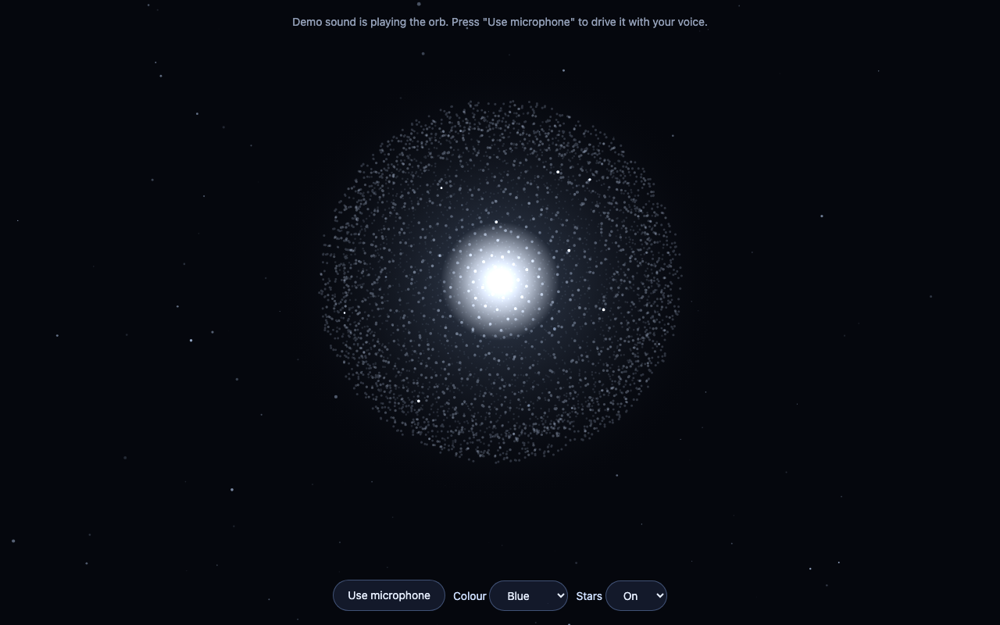

# Voice Orb

A sphere of glowing particles that moves with sound. It is the orb from 7 Live, my personal voice assistant,
as one self-contained web page.



**Personal project.** The code is here to look at, not to reuse: see [LICENSE](LICENSE).

## Features

- **About 4,600 particles on a sphere**, drawn in 3D with perspective and a slow turn.
- **Reacts to sound in three bands:**
  - low sounds swell the whole sphere;
  - mid sounds ripple its surface;
  - high sounds throw sparks off the edge.
- **Bright core and halo** that breathe gently and grow with loudness.
- **3D starfield** behind the orb: 220 stars drift toward the viewer and twinkle, faster when the sound is loud.
- **Microphone or demo:** it starts with a built-in demo signal, and one button switches it to your microphone.
- **Five colours** (blue, green, amber, violet, rose) and a switch for the stars.
- **Reduced motion respected:** with the system's "reduce motion" setting on, the orb and the stars hold still.
- **Private:** sound is analysed inside the page. Nothing is recorded, stored or sent anywhere.
- **No dependencies:** one HTML file, plain Canvas 2D and Web Audio. No build step, no libraries, no network calls.
- **Light on the machine:** points are batched into six depth layers, so a frame is a handful of draw calls.

## See it run

Open `index.html` in a browser. The microphone button needs the page to be served from `localhost` or HTTPS:

```
python3 -m http.server 8000
```

Then open http://localhost:8000.

## Licence

All rights reserved. You may view the source and run the page to see it. Copying, modifying, redistributing
and commercial use need my written permission. The full terms are in [LICENSE](LICENSE).
